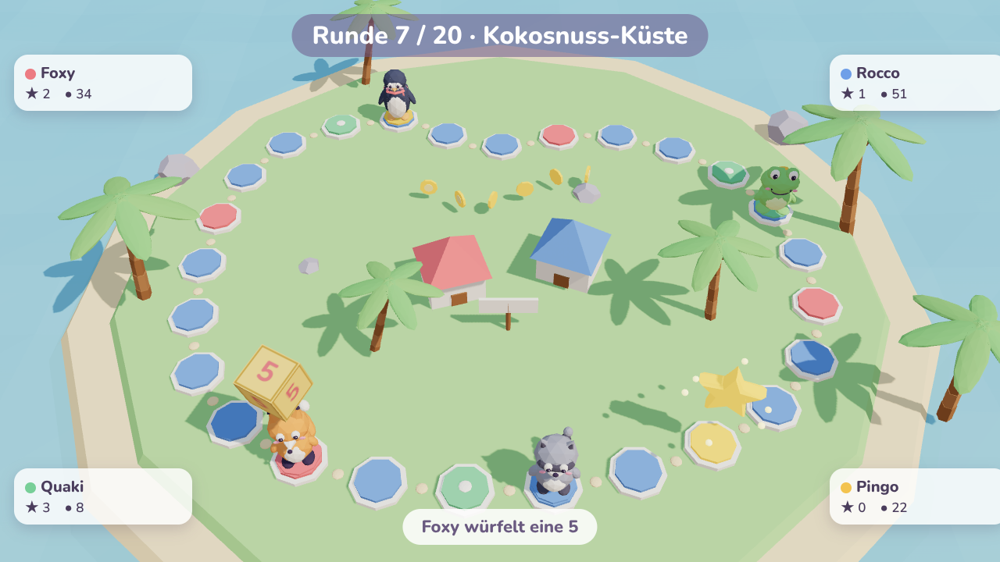
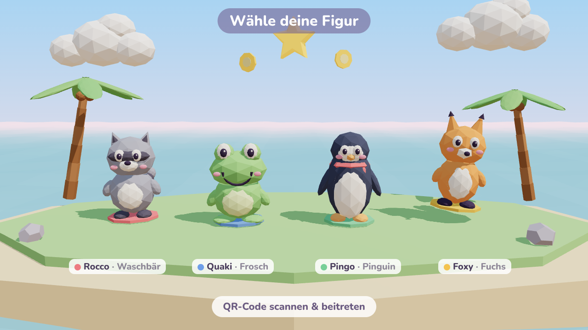
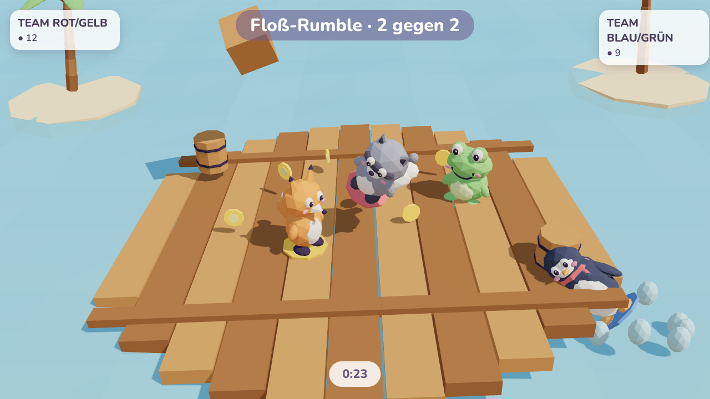

# Würfel-Bande – Anforderungsspezifikation (Leitplanken)

> **Status:** Entwurf v0.1 · **Stand:** 19.10.2026 · **Art:** Anforderungs-Spec, *keine* Umsetzung
> **Arbeitstitel:** „Würfel-Bande“ – ein 3D-Party-Brettspiel im Browser, inspiriert vom Genre „Mario Party“.

Dieses Dokument legt die **Leitplanken** fest: was das Spiel ist, was es nicht ist, und welche
Rahmenbedingungen jede spätere Design- und Technikentscheidung einhalten muss. Details
(konkrete Map-Layouts, finale Minispiel-Regeln, Balancing-Zahlen) werden in der Umsetzung
ausgearbeitet und gegen diese Leitplanken geprüft.

Anforderungen tragen IDs (`GAME-01`, `TECH-03` …). **MUSS** = verbindlich für Release v1,
**SOLL** = stark gewünscht, **KANN** = optional.

---

## 1. Vision

> Freunde sitzen gemeinsam vor dem Fernseher. Ein Laptop zeigt eine bunte 3D-Insel, alle scannen
> einen QR-Code und haben Sekunden später ihr Handy als Controller in der Hand. Es wird gewürfelt,
> gestichelt, Münzen geklaut, und nach jeder Runde gibt es ein chaotisches Minispiel. Am Ende
> entscheidet ein Bonus-Stern in letzter Sekunde, wer die Bande anführt.

**Design-Säulen**

1. **Sofort mitspielen:** Kein Account, keine App-Installation. QR scannen, Name eingeben, los.
2. **Couch-Chaos statt Esport:** Glück und Aufholjagd halten alle bis zur letzten Runde im Spiel.
3. **Lesbar aus 3 Metern:** Grafik, UI und Ansagen funktionieren auf dem TV aus Sofa-Distanz.
4. **Fast kostenlos zu betreiben:** Im Leerlauf ~0 €, Spiellogik läuft im Browser des Hosts.

---

## 2. Scope

### 2.1 In Scope (Release v1, ein einziges Release)

| Bereich | Umfang v1 |
|---|---|
| Spielmodi | Brett-Partie (Hauptmodus) + Minispiel-Marathon (Schnellmodus) |
| Spieler | 2–4 menschliche Spieler pro Lobby, mit CPU-Bots auf 4 aufgefüllt |
| Maps | 3: Kokosnuss-Küste, Vulkan-Gipfel, Bimmelbahn-Stadt |
| Minispiele | ~20 Minispiele + 1 Final-Minispiel |
| Figuren | 4 spielbare Helden der Tier-Crew + 1 Moderator-Figur |
| Items | 6–8 Items |
| Sprache | Deutsch (vollständig i18n-fähig) |
| Plattform | Host: Desktop-Browser am TV · Controller: Smartphone-Browser |
| Betrieb | Azure, Scale-to-Zero |

### 2.2 Out of Scope (bewusst ausgeschlossen, ggf. später)

- **Remote-Spieler**, also Mitspieler an einem anderen Ort. Alle Spieler sind im selben Raum vor demselben Bildschirm.
- **Zuschauer-Rolle** am Handy (Publikums-Joker, Abstimmungen).
- Accounts, Login, Freundeslisten, dauerhafte Profile/Statistiken.
- Öffentliches Matchmaking, Server-Browser.
- Monetarisierung (Werbung, In-App-Käufe).
- Native Apps (iOS/Android/Konsole), Smart-TV-Browser, Tablet als Host.
- Map 4 „Spukvilla“ → erstes Content-Update nach v1.
- Englische Lokalisierung → nach v1 (Architektur muss sie aber ermöglichen).
- Teams auf dem Spielbrett (Teams existieren nur in Minispielen).

---

## 3. Spielsituation & Zielgruppe

- **Zielgruppe:** Freunde, Familie, Spieleabende, Büro-Feierabend. Gelegenheitsspieler ab ~8 Jahren.
- **Verbreitung:** privat per geteilter URL; technisch so gebaut, dass eine spätere öffentliche Freigabe möglich bleibt.
- **Setting:** ein Raum, ein großer Bildschirm (TV/Beamer) mit Laptop/PC als **Host**, jeder Spieler mit eigenem Smartphone als **Controller**.
- **Partiedauer:** lang wie das Original. 20, 25 oder 30 Runden (≈ 60–90 Min.). Der Schnellmodus dauert ≈ 15 Min.

| ID | Anforderung | Prio |
|---|---|---|
| GAME-01 | Eine Partie unterstützt 2–4 menschliche Spieler; fehlende Plätze werden mit CPU-Bots auf 4 aufgefüllt (abschaltbar ab 3 Menschen). | MUSS |
| GAME-02 | Rundenzahl wählbar: 20 / 25 / 30. | MUSS |
| GAME-03 | Der Host-Bildschirm benötigt während der Partie **keine** Maus/Tastatur-Bedienung. | MUSS |

---

## 4. Ablauf einer Session

```
Host öffnet Seite ─► Lobby (QR + Raumcode) ─► Spieler joinen am Handy
   ─► Bandenchef wählt Modus/Map/Runden/Bots ─► Figurenwahl ─► Intro der Map (Moderator)
   ─► Reihenfolge auswürfeln ─► [ Brett-Runde: alle 4 Züge ─► Minispiel ─► Ergebnis ] × N
        (ab 5 Runden vor Schluss: „Finale“-Event)
   ─► Siegerehrung: Bonus-Sterne ─► Gewinner ─► Statistik-Screen ─► Revanche / zurück zur Lobby
```

### 4.1 Lobby & Beitritt

| ID | Anforderung | Prio |
|---|---|---|
| LOBBY-01 | Der Host erstellt eine Lobby mit einem Klick und zeigt **QR-Code + 4-stelligen Raumcode** (ohne verwechselbare Zeichen wie 0/O, 1/I). | MUSS |
| LOBBY-02 | Beitritt **anonym**: Nickname (max. 12 Zeichen) + Figur wählen. Kein Account, keine Installation. | MUSS |
| LOBBY-03 | Das **erste beigetretene Handy ist „Bandenchef“** und hat Admin-Rechte: Modus, Map, Rundenzahl, Bots/Bot-Stärke, Start, Pause, Spieler entfernen. Die Rolle ist übertragbar und geht bei Verbindungsabbruch automatisch an den nächsten Spieler. | MUSS |
| LOBBY-04 | Jede Figur ist pro Lobby nur einmal wählbar; zusätzlich hat jeder Spieler eine Spielerfarbe (Rot/Blau/Grün/Gelb) als Ring unter der Figur und in der UI. | MUSS |
| LOBBY-05 | Reconnect: Ein Spieler, der Tab/Verbindung verliert, kehrt über ein im Browser gespeichertes Session-Token auf seinen Platz zurück. Solange er weg ist, übernimmt ein Bot. | MUSS |
| LOBBY-06 | Raumcodes verfallen nach 2 h Inaktivität; gespeicherte Partien bleiben 7 Tage fortsetzbar (siehe TECH-Persistenz). | MUSS |
| LOBBY-07 | Einfacher Nickname-Filter (Blockliste), damit eine spätere öffentliche Nutzung möglich ist. | SOLL |

### 4.2 Spielmodi

| ID | Anforderung | Prio |
|---|---|---|
| MODE-01 | **Brett-Partie:** klassischer Ablauf aus Brett-Runden und Minispielen, Ziel: meiste Sterne. | MUSS |
| MODE-02 | **Minispiel-Marathon:** 10 zufällige Minispiele (gemischte Formate) mit Punktetabelle, letztes Spiel zählt doppelt, ≈ 15 Min. | MUSS |
| MODE-03 | Minispiel-Auswahl im Marathon: Zufall ohne Wiederholung; Bandenchef kann einzelne Minispiele abwählen. | SOLL |

---

## 5. Brett-Kernmechaniken

### 5.1 Ziel & Währungen

- **Münzen** sammelt man über Felder, Minispiele und Ereignisse.
- **Sterne** kauft man für Münzen am **wandernden Stern-Feld**. Nach jedem Kauf springt es zu einer anderen vordefinierten Position der Map.
- **Sieg:** meiste Sterne nach der letzten Runde inkl. Bonus-Sternen; Gleichstand → mehr Münzen → Würfelentscheid.

**Balancing-Startwerte (Richtwerte, im Playtest anpassbar):**

| Parameter | Startwert |
|---|---|
| Startmünzen | 10 |
| Würfel | 1–10 |
| Blaues Feld / Rotes Feld | +3 / −3 Münzen (im Finale ×2) |
| Sternpreis | 20 Münzen |
| Minispiel-Gewinn (FFA) | +10 (1. Platz), gestaffelt für Platz 2–3 |
| Max. Items im Inventar | 3 |

### 5.2 Feldtypen

| Feld | Wirkung |
|---|---|
| Blau | + Münzen |
| Rot | − Münzen |
| Ereignis (grün) | löst das **Map-Gimmick** aus (siehe Kapitel 6) |
| Glücksfeld | Glücksrad: Münzen, Item, Münzen tauschen, Bonus-Minispiel … |
| Duell-Feld | 1v1-Duell-Minispiel gegen einen gewählten Gegner um Münzen |
| Item-Feld | gibt zufälliges Item |
| Shop | Item-Kauf beim Vorbeilaufen |
| Stern-Feld | Stern kaufen beim Vorbeilaufen (wandert) |

| ID | Anforderung | Prio |
|---|---|---|
| BOARD-01 | **Abzweigungen:** An Weggabelungen wählt der aktive Spieler die Richtung **am Handy**. Der TV zeigt die Optionen mit Pfeilen. | MUSS |
| BOARD-02 | Felder werden beim **Vorbeilaufen** (Stern, Shop) bzw. beim **Stehenbleiben** (alle anderen) ausgelöst. | MUSS |
| BOARD-03 | Jede Map hat ein **starkes, eigenes Gimmick**, das den Spielverlauf sichtbar verändert (nicht nur Kosmetik). | MUSS |
| BOARD-04 | Brett-Züge sind sequentiell; Wartezeit pro Spieler-Zug ≤ ~30 s (Animationen beschleunigbar, „Vorspulen“ hält der Bandenchef). | SOLL |
| BOARD-05 | Alle Ereignisse werden vom **Moderator** kurz angesagt (Stimme + Text). | MUSS |

### 5.3 Items (6–8, max. 3 im Inventar)

Items werden im Shop gekauft oder auf Item-/Glücksfeldern gefunden. **Vorschlag:**

| Item | Wirkung | Preis (Richtwert) |
|---|---|---|
| Doppelwürfel | 2 Würfel werfen | 5 |
| Turbo-Würfel | 3 Würfel werfen | 10 |
| Mini-Würfel | Würfel 1–3 (präzise Landung) | 3 |
| Warp-Muschel | Position mit zufälligem Spieler tauschen | 8 |
| Klau-Handschuh | Beim Überholen 5–15 Münzen klauen | 7 |
| Fallenstein | Auf ein Feld legen; wer darauf landet, zahlt dem Leger 10 Münzen | 6 |
| Schutzschirm | Blockt den nächsten Klau/die nächste Falle | 5 |
| Stern-Klau-Ticket | Beim Überholen einen Stern stehlen (nur Shop, selten) | 30 |

| ID | Anforderung | Prio |
|---|---|---|
| ITEM-01 | Items werden am **Handy** (privat) ausgewählt und vor dem Würfeln eingesetzt. | MUSS |
| ITEM-02 | Inventar ist auf 3 Items begrenzt; bei vollem Inventar Abfrage „ersetzen oder verwerfen“. | MUSS |

### 5.4 Party-Chaos & Aufholjagd

| ID | Anforderung | Prio |
|---|---|---|
| CHAOS-01 | **Finale (letzte 5 Runden):** Der Moderator kündigt den Zwischenstand an; Blau/Rot-Felder wirken doppelt; der Letztplatzierte darf am Glücksrad drehen (Münzen / Item / Stern-Rabatt). | MUSS |
| CHAOS-02 | **Bonus-Sterne:** Am Ende werden **3 Bonus-Sterne aus einem Pool von ~6 Kategorien zufällig gezogen** (z. B. Minispiel-Ass, Münzen-Magnet, Wandervogel = meiste Felder gelaufen, Pechvogel = meiste rote Felder, Kauflaune = meiste Münzen ausgegeben, Duell-Champion). | MUSS |
| CHAOS-03 | Bonus-Kategorien werden dramatisch einzeln enthüllt. Ein Spieler mit Rückstand muss rechnerisch bis zum Ende gewinnen können. | SOLL |

### 5.5 CPU-Bots

| ID | Anforderung | Prio |
|---|---|---|
| BOT-01 | Bots in 3 Stärken (leicht / mittel / schwer) füllen auf 4 Spieler auf. | MUSS |
| BOT-02 | Bots übernehmen sofort für Spieler mit Verbindungsabbruch und geben den Platz beim Reconnect zurück. | MUSS |
| BOT-03 | **Jedes Minispiel MUSS ein Bot-Verhalten haben.** Ein Minispiel ohne Bot-KI gilt als nicht fertig. | MUSS |
| BOT-04 | Bots treffen auf dem Brett plausible Entscheidungen (Abzweigung Richtung Stern, Item-Einsatz, Shop). | MUSS |

---

## 6. Maps

### 6.1 Leitplanken für alle Maps

| ID | Anforderung | Prio |
|---|---|---|
| MAP-01 | 40–60 Felder, 2–4 Abzweigungen, 1–2 Shops, ≥ 5 mögliche Stern-Positionen. | MUSS |
| MAP-02 | Ein **dominantes Gimmick** pro Map, das am TV klar angekündigt und sichtbar animiert wird. | MUSS |
| MAP-03 | Gesamtes Brett muss aus einer Übersichtskamera lesbar sein; Kamera folgt dem aktiven Spieler und zoomt bei Ereignissen. | MUSS |
| MAP-04 | Eigener Musik-Track je Map (inkl. Finale-Variante). | MUSS |
| MAP-05 | Schwierigkeit/Komplexität ist gestaffelt (Einsteiger → Mittel → Komplex). | SOLL |

### 6.2 Map 1 – Kokosnuss-Küste (Einsteiger)

Tropeninsel mit Palmen, Strandhütten, Stegen. *Siehe Mockup unten.*

- **Gimmick „Gezeiten“:** Alle 3 Runden wechseln Ebbe und Flut. Bei Ebbe tauchen Sandbank-Abkürzungen auf. Bei Flut werden sie überspült, und wer dort steht, wird zum nächsten sicheren Feld zurückgespült.
- **Ereignisfeld „Kokos-Kanone“:** schießt den Spieler auf ein zufälliges Feld der Insel.
- **Shop:** Krabben-Händler am Steg.

### 6.3 Map 2 – Vulkan-Gipfel (Mittel)

Feuerinsel mit Rundweg um einen aktiven Vulkan, Lavaflüssen, Obsidian, Seilbahn.

- **Gimmick „Ausbruch“:** Jedes rote Feld erhöht einen sichtbaren **Ausbruchs-Zähler**. Bei vollem Zähler bricht der Vulkan aus. Einzelne Wege werden für 1 Runde zu Lava, und es regnet Münzen und Gesteinsbrocken: Münzen auf zufällige Felder, Brocken kosten getroffene Spieler Münzen.
- **Seilbahn:** kostenpflichtige Abkürzung (z. B. 5 Münzen) zum Gipfel, wo der Stern oft liegt.

### 6.4 Map 3 – Bimmelbahn-Stadt (Komplex)

Comic-Kleinstadt mit Bahnhöfen, Läden, Bahnübergängen.

- **Gimmick „Zug“:** Nach jeder Runde fährt ein Zug nach **sichtbarem Fahrplan** über die Gleise. Wer auf den Gleisen steht, wird überrollt und verliert Münzen.
- **Tickets:** Mit Tickets fährt man selbst von Bahnhof zu Bahnhof.
- **Stern:** liegt in wechselnden Läden.

### 6.5 Map 4 – Spukvilla (nach v1, Content-Update)

Gruselig-niedliches Herrenhaus. Ein wandernder Geist klaut Münzen, Räume drehen sich bei Ereignisfeldern, und Geheimtüren brauchen Schlüssel. **Nicht Teil von v1**, die Architektur muss neue Maps aber ohne Engine-Änderungen ermöglichen (MAP-06).

| ID | Anforderung | Prio |
|---|---|---|
| MAP-06 | Maps sind **datengetrieben** (Feldgraph, Stern-Positionen, Gimmick-Skript getrennt von der Engine), sodass neue Maps als Content nachgeliefert werden können. | MUSS |

---

## 7. Minispiele

### 7.1 Leitplanken

| ID | Anforderung | Prio |
|---|---|---|
| MINI-01 | ~20 Minispiele zum Release + 1 Final-Minispiel. | MUSS |
| MINI-02 | Formate: **Jeder gegen Jeden (FFA)**, **2 vs 2**, **1 vs 3**, **Duell (1v1)**. Teams werden über die Brett-Felder bestimmt, auf denen die Spieler stehen (Farbe der Felder) oder zufällig. | MUSS |
| MINI-03 | Dauer pro Minispiel: **30–60 s** Spielzeit. | MUSS |
| MINI-04 | Vor jedem Spiel: **Erklär-Screen** (TV) mit Steuerungs-Grafik und **Übungsphase**. Start erst, wenn alle „Bereit“ gedrückt haben (oder nach 30 s). | MUSS |
| MINI-05 | Jedes Minispiel nutzt **eine** klar erkennbare Steuerungsart (siehe 7.2); das Handy zeigt das passende Controller-Layout. | MUSS |
| MINI-06 | Jedes Minispiel funktioniert mit Bots (BOT-03) und mit 2–4 Menschen. | MUSS |
| MINI-07 | Minispiele sind als **Module** mit einheitlicher Schnittstelle gebaut (Setup, Input, Tick, Ergebnis, Bot-KI), damit neue Minispiele leicht ergänzt werden können. | MUSS |
| MINI-08 | Ziel-Mix der Steuerungsarten: keine Steuerungsart > 40 % der Minispiele. | SOLL |
| MINI-09 | Minispiele sind thematisch an die Welt angepasst (Insel/Vulkan/Stadt), aber auf jeder Map spielbar. | SOLL |

### 7.2 Steuerungsarten am Handy

| Steuerung | Einsatz | Latenz-Empfindlichkeit |
|---|---|---|
| **Touch-Joystick + 1–2 Buttons** | Laufen, Springen, Schubsen | hoch → nur im lokalen WLAN mit P2P (siehe TECH) |
| **Tippen / Mashen / Timing** | Schnell tippen, im richtigen Moment drücken, Rhythmus | gering → Zeitstempel werden **am Handy** gemessen |
| **Gyro / Neigen / Schütteln** | Balancieren, Zielen, Aufpumpen | mittel; iOS erfordert Berechtigungsabfrage |
| **Zeichnen / Wischen / Quiz** | Formen nachziehen, Reihenfolgen, Wissens-/Reaktionsfragen | keine |

### 7.3 Minispiel-Katalog (Vorschlag, ~20 + Finale)

| # | Name | Format | Steuerung | Kurzbeschreibung |
|---|---|---|---|---|
| 1 | Kokos-Regen | FFA | Joystick | Fallende Kokosnüsse fangen, Steinen ausweichen. |
| 2 | Schubs-Scholle | FFA | Joystick + Button | Sumo auf einer schmelzenden Eisscholle. |
| 3 | Gipfel-Sprint | FFA | Mashen | Durch schnelles Tippen den Vulkan hochrennen. |
| 4 | Wackel-Brücke | FFA | Gyro | Murmel über eine kippende Hängebrücke balancieren. |
| 5 | Zehn-Sekunden-Zauber | FFA | Timing | Blind exakt nach 10,00 s drücken. |
| 6 | Strich-Künstler | FFA | Zeichnen | Vorgegebene Form am schnellsten/genauesten nachziehen. |
| 7 | Zähl-Zoo | FFA | Quiz | Vorbeilaufende Tiere zählen, am nächsten dran gewinnt. |
| 8 | Lava-Seilspringen | FFA | Timing (Button) | Über einen rotierenden Lavabalken springen. |
| 9 | Floß-Rumble | 2v2 | Joystick + Button | Gegnerteam vom Floß schubsen (siehe Mockup). |
| 10 | Tandem-Tretboot | 2v2 | Rhythmus | Abwechselnd im Takt tippen, um das Boot zu steuern. |
| 11 | Paket-Kette | 2v2 | Wischen | Pakete zwischen Teammitgliedern weiterwischen. |
| 12 | Weichen-Chaos | 2v2 | Timing | Weichen stellen, um Züge zum eigenen Bahnhof zu leiten. |
| 13 | Schatz-Tauziehen | 2v2 | Schütteln | Tauziehen durch Handy-Schütteln. |
| 14 | Kokos-Kanonier | 1v3 | Gyro-Zielen vs. Joystick | Einer zielt mit der Kanone, drei weichen aus. |
| 15 | Wand-Labyrinth | 1v3 | Wischen vs. Joystick | Einer verschiebt Wände, drei suchen den Ausgang. |
| 16 | Laternen-Jagd | 1v3 | Joystick | Einer versteckt sich im Dunkeln, drei suchen mit Laternen. |
| 17 | Ballon-Bombardement | 1v3 | Schütteln vs. Tippen | Drei pumpen Ballons auf, einer zerplatzt sie. |
| 18 | Schnellzieher | Duell | Reaktion | Bei „JETZT!“ als Erster tippen; Frühstart = Niederlage. |
| 19 | Schnick-Schnack-Schnuck Deluxe | Duell | Auswahl | Gleichzeitige geheime Wahl, 3 Gewinnsätze. |
| 20 | Memo-Duell | Duell | Tippen | Wachsende Farb-/Ton-Sequenz nachspielen. |
| F | **Gipfelsturm** (Finale) | FFA | gemischt | Mehrstufiger Parcours, der mehrere Steuerungsarten kombiniert. Abschluss des Schnellmodus und optionales Event im Finale. |

> Der Katalog ist ein **Vorschlag**. Austausch einzelner Spiele ist erlaubt, solange MINI-01 bis
> MINI-09 eingehalten werden (Formate-Mix etwa 8 FFA / 5×2v2 / 4×1v3 / 3 Duell).

---

## 8. Handy-Controller (UX)

| ID | Anforderung | Prio |
|---|---|---|
| CTRL-01 | Das Handy ist **reiner Controller + private Infos** (Inventar, Münzen/Sterne, Auswahlmenüs, Bestätigungen). Das Spielgeschehen läuft ausschließlich auf dem TV. | MUSS |
| CTRL-02 | Das Controller-Layout wechselt kontextabhängig: Würfeln → Item-Auswahl → Abzweigung → Shop → Minispiel-Controller → Warten. | MUSS |
| CTRL-03 | Im Wartezustand zeigt das Handy, wer dran ist, und einfache Reaktionen (Emojis, die am TV kurz bei der Figur erscheinen). | SOLL |
| CTRL-04 | Touch-Ziele ≥ 48 px, Einhand-Bedienung im Brett-Modus, Hoch- und Querformat je nach Minispiel (mit Hinweis zum Drehen). | MUSS |
| CTRL-05 | Display-Sperre wird während der Partie verhindert (Wake Lock); Vibrations-Feedback, wo das Gerät es unterstützt. | SOLL |
| CTRL-06 | Gyro-Berechtigung (iOS) wird **einmalig beim Beitritt** angefragt, nicht mitten im Minispiel. | MUSS |
| CTRL-07 | Der Controller lädt schnell: Ziel < 2 MB initial, **keine 3D-Engine** auf dem Handy. | MUSS |

---

## 9. Welt, Figuren & Art Direction

### 9.1 Figuren

| Figur | Tier | Charakter (Vorschlag) |
|---|---|---|
| **Rocco** | Waschbär | Schlitzohr, liebt glänzende Münzen |
| **Quaki** | Frosch | Fröhlicher Angeber mit Mini-Krone |
| **Pingo** | Pinguin | Cool, trägt Schal, rutscht überall hin |
| **Foxy** | Fuchs | Schlau, schnell, ehrgeizig |
| *Moderator* | Papagei (Vorschlag: „Käpt'n Plapperschnabel“) | Spielleiter, sagt Ereignisse an, kommentiert frech |

| ID | Anforderung | Prio |
|---|---|---|
| ART-01 | **Eigene IP:** keine Nintendo-Namen, -Figuren, -Logos, -Musik oder nachgebaute Original-Assets. | MUSS |
| ART-02 | Jede Figur hat Animationen für: Idle, Laufen, Springen, Jubeln, Ärgern, Getroffen, Würfeln; plus Gebrabbel-Stimme. | MUSS |
| ART-03 | Figuren sind am TV aus 3 m Entfernung an Silhouette + Spielerfarbe unterscheidbar. | MUSS |

### 9.2 Grafikstil: Stylized Low-Poly

Entschieden nach Mockup-Vergleich (Cel-Shading vs. Low-Poly):

| Brett | Figurenwahl | Minispiel |
|---|---|---|
|  |  |  |

*Mockups sind prozedural gebaute Platzhalter, sie zeigen Stimmung, Farbwelt und UI-Richtung, nicht die finale Asset-Qualität. Stilvergleich: [stilvergleich.png](mockups/stilvergleich.png).*

| ID | Anforderung | Prio |
|---|---|---|
| ART-04 | **Stylized Low-Poly:** facettierte Geometrie (Flat Shading), Pastell-Palette, weiche Schatten, leichter Nebel/Farbverlauf-Himmel. | MUSS |
| ART-05 | Eine **zentrale Farbpalette** pro Map; alle Assets (auch CC0/KI-generierte) werden auf diese Palette angepasst, damit kein Stilbruch entsteht. | MUSS |
| ART-06 | UI-Stil: abgerundete, halbtransparente Karten, freundliche runde Schrift (z. B. Nunito), große Typo für TV-Lesbarkeit. | MUSS |
| ART-07 | Spielerfarben (Rot/Blau/Grün/Gelb) sind zusätzlich zur Farbe über **Form/Icon** unterscheidbar (Farbenblindheit). | SOLL |

### 9.3 Asset-Pipeline

| ID | Anforderung | Prio |
|---|---|---|
| ASSET-01 | **Basis:** CC0-Pakete (z. B. Quaternius, Kenney, Poly Pizza) für Umgebung und Props. | MUSS |
| ASSET-02 | **Helden, Moderator & Map-Wahrzeichen:** mit KI-3D-Tools (z. B. Meshy, Tripo) erzeugt, in **Blender** auf Low-Poly retopologisiert, eingefärbt (Palette) und geriggt. | MUSS |
| ASSET-03 | Format **glTF/GLB**, Mesh-Kompression (Draco oder meshopt), Texturen als KTX2 wo sinnvoll. | MUSS |
| ASSET-04 | **Polygon-Budgets:** Figur ≤ 5 k Dreiecke; Map-Szene gesamt ≤ 300 k Dreiecke; ≤ 300 Draw Calls am Host. | MUSS |
| ASSET-05 | **Lizenz-Register:** Jedes Asset (3D, Audio, Font) wird mit Quelle, Lizenz, Tool/Tarif und Datum in einer Liste im Repo geführt. | MUSS |

---

## 10. Audio

| ID | Anforderung | Prio |
|---|---|---|
| AUDIO-01 | **Musik (Suno):** je Map ein Loop-Track + Finale-Variante; Menü/Lobby, Minispiel-Tracks (3–4 Varianten nach Stimmung), Siegerehrung, Jingles (Stern, Item, Ausbruch, Zug). | MUSS |
| AUDIO-02 | **SFX (ElevenLabs):** Würfel, Schritte, Münzen, Felder, UI, Minispiel-Effekte, Gimmicks. | MUSS |
| AUDIO-03 | **Moderator-Stimme (ElevenLabs):** kurze deutsche Ansagen (Rundenstart, Stern, Finale, Minispiel-Titel, Gewinner). Texte liegen als i18n-Keys vor, damit sie für weitere Sprachen neu vertont werden können. | MUSS |
| AUDIO-04 | **Figuren-Gebrabbel:** Fantasiesprache statt echter Sätze (sprachunabhängig). | MUSS |
| AUDIO-05 | Audio läuft **nur am Host**; am Handy höchstens dezentes UI-Feedback (abschaltbar). | MUSS |
| AUDIO-06 | Lautstärke getrennt für Musik / Effekte / Stimme am Host einstellbar. | SOLL |
| AUDIO-07 | Nutzungsrechte der Suno-/ElevenLabs-Ausgaben werden je Tarif geprüft und im Lizenz-Register dokumentiert (für spätere öffentliche Nutzung ggf. bezahlter Tarif nötig). | MUSS |

---

## 11. Technische Leitplanken

### 11.1 Architektur-Überblick

```
 ┌───────────────────────── Wohnzimmer ─────────────────────────┐
 │  Host (Laptop am TV)                    Handys (Controller)  │
 │  Babylon.js + Havok                     leichte Web-UI       │
 │  ★ Spiel-Autorität (State, Regeln,  ◄──WebRTC DataChannel──► │
 │    Minispiele, Bots)                    (P2P, Eingaben/UI)   │
 └──────────┬───────────────────────────────────────┬───────────┘
            │ WebSocket: Lobby, Signaling,          │ WebSocket-Relay
            │ Autosave                              │ (nur Fallback)
            ▼                                       ▼
 ┌──────────────────────────── Azure ────────────────────────────┐
 │ Static Web Apps (Free)  → Host- & Controller-Client           │
 │ Blob Storage            → große Assets (GLB, Audio)           │
 │ Container Apps (Consumption, 0–1 Replica) → Node.js-Server:   │
 │    Lobby-Registry · Signaling · WS-Relay · Save-API           │
 │ Table Storage           → Spielstände (7 Tage)                │
 │ Application Insights    → anonyme Telemetrie & Fehler         │
 └───────────────────────────────────────────────────────────────┘
```

### 11.2 Client & Engine

| ID | Anforderung | Prio |
|---|---|---|
| TECH-01 | Host-Client: **Babylon.js** mit **Havok**-Physik, TypeScript. WebGL2 als Pflicht, WebGPU optional. | MUSS |
| TECH-02 | Zwei Einstiegspunkte: **`/host`** (3D, TV) und **`/play`** (Controller, ohne 3D-Engine). Gemeinsame Typdefinitionen für das Nachrichtenprotokoll. | MUSS |
| TECH-03 | **Host ist Spiel-Autorität:** Spielzustand, Regeln, Zufall, Minispiel-Simulation und Bots laufen im Host-Browser. Handys senden nur Eingaben und erhalten Anzeige-Zustände. | MUSS |
| TECH-04 | Der Spielzustand ist **vollständig serialisierbar** (JSON) und kann jederzeit gespeichert/wiederhergestellt werden. | MUSS |
| TECH-05 | Alle Texte über i18n-Keys; keine hartcodierten UI-Strings. | MUSS |

### 11.3 Netzwerk

| ID | Anforderung | Prio |
|---|---|---|
| NET-01 | Verbindung Host ↔ Handy über **WebRTC DataChannels** (P2P). Signaling über den eigenen Server per WebSocket; öffentlicher STUN-Server. | MUSS |
| NET-02 | Zwei Kanäle: **zuverlässig/geordnet** für Spielereignisse und **unzuverlässig/ungeordnet** für Echtzeit-Eingaben (Joystick, ~30 Hz). | MUSS |
| NET-03 | **Fallback:** Kommt binnen ~5 s keine P2P-Verbindung zustande, läuft der Verkehr automatisch über einen **WebSocket-Relay** auf demselben Server. Kein TURN-Server in v1. | MUSS |
| NET-04 | Latenz-Ziel Eingabe → Bild am TV: **< 100 ms** im lokalen WLAN (P2P). | SOLL |
| NET-05 | Timing-/Reaktions-Minispiele messen Eingaben **am Handy mit synchronisierter Uhr** (Ping-basierte Offset-Messung), damit Netzwerklatenz das Ergebnis nicht verfälscht. | MUSS |
| NET-06 | Verbindungsverlust wird am TV angezeigt (Spieler-Icon), Bot übernimmt (BOT-02). | MUSS |

### 11.4 Persistenz & Robustheit

| ID | Anforderung | Prio |
|---|---|---|
| SAVE-01 | **Autosave nach jeder Brett-Runde** an den Server (Table Storage), zusätzlich lokal im Host-Browser. | MUSS |
| SAVE-02 | Eine gespeicherte Partie kann **bis 7 Tage** per Code fortgesetzt werden; Spieler ordnen sich beim Rejoin ihrer Figur zu. | MUSS |
| SAVE-03 | Lädt der Host-Tab neu, wird die Partie automatisch ab dem letzten Stand fortgesetzt; Handys verbinden sich selbstständig neu. | MUSS |
| SAVE-04 | Bandenchef kann pausieren; Pause stoppt Timer und Minispiele. | MUSS |

### 11.5 Performance & Gerätesupport

| ID | Anforderung | Prio |
|---|---|---|
| PERF-01 | Host: **1080p mit 60 fps** auf einem Mittelklasse-Laptop mit integrierter Grafik (Referenzgerät wird in der Umsetzung festgelegt); Qualitätsstufen (Schatten, Auflösung) automatisch absenkbar. | MUSS |
| PERF-02 | Host-Erstladen < 50 MB; Maps werden **lazy** nachgeladen (≤ 25 MB je Map). Ladebildschirm mit Fortschritt. | SOLL |
| PERF-03 | Host-Browser: aktuelle Desktop-Versionen von Chrome, Edge, Firefox, Safari. Smart-TV-Browser und Tablets werden nicht unterstützt. | MUSS |
| PERF-04 | Controller: iOS Safari (aktuelle + vorherige Hauptversion), Android Chrome (aktuell). | MUSS |
| PERF-05 | Kaltstart des Servers (Scale-to-Zero) ist akzeptiert; der Host zeigt „Server wird geweckt …“ (Ziel < 15 s). | MUSS |

---

## 12. Hosting & Kosten (Azure)

| Baustein | Dienst | Zweck | Kosten-Erwartung |
|---|---|---|---|
| Web-Clients | **Azure Static Web Apps – Free** | `/host`, `/play`, kleine Assets (Limit 250 MB/App, 100 GB Traffic/Monat) | 0 € |
| Große Assets | **Blob Storage** (LRS, Hot) | GLB-Modelle, Musik, Stimme | Cent-Bereich |
| Server | **Azure Container Apps – Consumption**, min 0 / max 1 Replica, 0,25 vCPU / 0,5 GiB | Lobby, Signaling, WS-Relay, Save-API | Im monatlichen Freikontingent (180 k vCPU-s, 360 k GiB-s, 2 Mio. Requests) |
| Spielstände | **Table Storage** | Autosaves (TTL 7 Tage) | Cent-Bereich |
| Container-Image | **GitHub Container Registry** | Image-Ablage, vermeidet die Grundgebühr von Azure Container Registry | 0 € |
| Telemetrie | **Application Insights** | anonyme Events, Fehler, Performance | im Freikontingent |

| ID | Anforderung | Prio |
|---|---|---|
| OPS-01 | Kosten im Leerlauf ≈ 0 €; **Obergrenze < 15 €/Monat** bei gelegentlicher Nutzung (einige Partien pro Woche). | MUSS |
| OPS-02 | **Azure-Budget-Alarm** bei 10 €/Monat. | MUSS |
| OPS-03 | Infrastruktur als Code (Bicep) und Deployment per GitHub Actions. | SOLL |
| OPS-04 | Server läuft mit max. 1 Replica (In-Memory-Lobby-Registry); horizontale Skalierung ist erst bei öffentlicher Nutzung ein Thema. | MUSS |

*Überschlag:* 10 Partien × 90 Min. ≈ 54 000 s × 0,25 vCPU ≈ 13 500 vCPU-s pro Monat, also etwa 7,5 % des Freikontingents.

---

## 13. Datenschutz, Sicherheit & Telemetrie

| ID | Anforderung | Prio |
|---|---|---|
| PRIV-01 | Keine personenbezogenen Daten: keine Accounts, keine E-Mail; Nicknames nur für die Dauer der Partie + Savegame. | MUSS |
| PRIV-02 | **Telemetrie minimal & anonym**, ohne Cookies/Tracking-IDs über Sessions hinweg: Partien gestartet/beendet, gewählte Map/Modus, Minispiel-Ergebnisse & -Dauer (Balancing), Fehler & Performance (fps, Ladezeit). | MUSS |
| PRIV-03 | Kein Cookie-Banner nötig (nur technisch notwendige lokale Speicherung: Session-Token). | SOLL |
| SEC-01 | Server validiert Raumcodes/Session-Tokens, begrenzt Lobby-Erstellung und Nachrichtenrate pro Verbindung (Missbrauch des Relays verhindern). | MUSS |
| SEC-02 | Cheat-Schutz ist **kein** Ziel (privates Spiel, Host-Autorität). | – |
| SEC-03 | Vor einer öffentlichen Freigabe: Impressum & Datenschutzerklärung ergänzen. | KANN |

---

## 14. Lokalisierung & Barrierefreiheit

| ID | Anforderung | Prio |
|---|---|---|
| L10N-01 | Release-Sprache **Deutsch**; alle Texte, Moderator-Ansagen und Minispiel-Erklärungen sind übersetzbar. Englisch nach v1. | MUSS |
| A11Y-01 | Spielerfarben zusätzlich mit Formen/Icons (ART-07); ausreichende Kontraste am TV. | SOLL |
| A11Y-02 | Optionaler „Ohne Schütteln/Gyro“-Filter: Bandenchef kann Gyro-/Schüttel-Minispiele abwählen. | SOLL |
| A11Y-03 | Untertitel für alle Moderator-Ansagen (immer an). | MUSS |

---

## 15. Rechtliches

- **Kein Nintendo-Material** (ART-01). „Mario Party“ dient nur intern als Genre-Referenz und taucht in keinem Produktnamen, Asset oder Marketing auf.
- Der Name „Würfel-Bande“ ist ein **Arbeitstitel**; vor einer öffentlichen Freigabe ist eine Marken-Kurzrecherche nötig.
- Alle Fremd- und KI-Assets laufen über das Lizenz-Register (ASSET-05, AUDIO-07).

---

## 16. Abnahmekriterien für Release v1 (Auszug)

- [ ] 4 Spieler (oder 2 Spieler + 2 Bots) spielen eine **komplette 20-Runden-Partie** auf jeder der 3 Maps ohne Absturz.
- [ ] Beitritt per QR in **< 30 s** pro Spieler (vom Scannen bis zur Figurenwahl).
- [ ] Alle ~20 Minispiele + Finale sind mit Menschen **und** Bots spielbar und haben Erklär-Screen + Übungsphase.
- [ ] Jede Map-Gimmick-Mechanik wird mindestens einmal pro Partie ausgelöst und vom Moderator angesagt.
- [ ] Host-Tab neu laden → Partie läuft vom letzten Autosave weiter; ein Handy verliert WLAN → Bot übernimmt → Rejoin funktioniert.
- [ ] Gespeicherte Partie lässt sich am nächsten Tag per Code fortsetzen.
- [ ] Host erreicht 60 fps (1080p) auf dem Referenz-Laptop; Controller lädt < 2 MB.
- [ ] P2P-Verbindung im Heim-WLAN; erzwungener Fallback auf WS-Relay funktioniert.
- [ ] Azure-Kosten im Testmonat < 15 €, Budget-Alarm eingerichtet.
- [ ] Lizenz-Register vollständig für alle Assets.

---

## 17. Offene Punkte (in der Umsetzung zu klären)

1. Konkrete Map-Layouts (Feldgraphen, Stern-Positionen) und Gimmick-Timings.
2. Finale Minispiel-Liste und -Regeln; Bot-Verhalten je Minispiel.
3. Balancing-Werte (Münzen, Preise, Bonus-Sterne-Pool) → per Playtest + Telemetrie.
4. Design & Name des Moderators, Logo, Titel-Screen.
5. Musikstil je Map (Prompt-Leitfaden für Suno), Stimmprofil des Moderators (ElevenLabs).
6. Referenz-Laptop für PERF-01.
7. Team-Zuteilung in Minispielen: über Feldfarbe (wie Original) oder immer zufällig.

---

## Anhang A – Entscheidungsprotokoll (Grilling-Session 19.10.2026)

| Frage | Entscheidung |
|---|---|
| Spielmodell | Gemeinsamer Bildschirm (Laptop am TV) + Handys als Controller |
| Remote-Spieler / Zuschauer | Out of Scope |
| Zielgruppe | Privat, aber öffentlich-fähig gebaut |
| Teams | Nur in Minispielen |
| Spielmodi | Brett + Minispiel-Marathon |
| Spieleranzahl | 2–4, Bots füllen auf |
| Partielänge | Lang wie das Original (20–30 Runden) |
| Beitritt | Anonym per QR/Code |
| Spielleiter | Erstes Handy = Bandenchef |
| Budget | ≈ 0 € Leerlauf, < 15 €/Monat |
| Welt | Tier-Crew im Comic-Land |
| Grafikstil | Stylized Low-Poly (nach Mockup-Vergleich) |
| Siegziel | Münzen → Sterne |
| Brettfelder | Klassik-Set + starke Map-Gimmicks |
| Items | Kleines Set (6–8, max. 3) |
| Balance | Party-Chaos mit Aufholjagd |
| Maps v1 | Küste, Vulkan, Bahn-Stadt; Spukvilla später |
| Minispiele | ~20, alle vier Steuerungsarten |
| Autorität | Host-Browser |
| Netzwerk | WebRTC P2P + WebSocket-Fallback |
| Engine | Babylon.js + Havok |
| Audio | Suno-Musik + ElevenLabs-SFX + Moderator-Stimme |
| Assets | CC0-Basis + KI-3D + Blender |
| Host-Gerät | Laptop/PC-Browser am TV |
| Azure | Static Web Apps + Container Apps + Table Storage |
| Titel | Würfel-Bande |
| Unterbrechungen | Autosave + 7 Tage Fortsetzen |
| Release | Alles in einem Release |
| Telemetrie | Minimal, anonym |
| Sprache | Deutsch, i18n-fähig |
